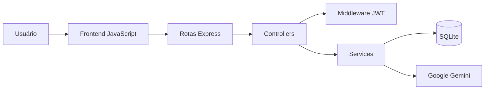

# Arquitetura do sistema

O projeto utiliza uma arquitetura em camadas. O frontend é servido pelo Express a partir de `public/`, enquanto a API fica organizada em rotas, controllers, middleware e services.

## Camadas

### Frontend

O diretório `public/` contém `index.html`, `script.js` e `style.css`. O navegador abre e processa os livros, captura a seleção e realiza chamadas HTTP para a API.

### Rotas

O diretório `src/routes/` define os verbos HTTP e conecta cada endpoint ao controller correspondente. As rotas não concentram regras de negócio.

### Controllers

O diretório `src/controllers/` valida os dados recebidos em `req`, chama os services e monta as respostas em `res`.

### Middleware

O `authMiddleware` valida o token JWT nas rotas que exigem autenticação.

### Services

O diretório `src/services/` contém a lógica de autenticação, acesso ao SQLite, flashcards e integração com o Gemini.

### Servidor

O arquivo `server.js` carrega as variáveis de ambiente, configura o Express, serve os arquivos públicos, inicializa o banco e inicia a aplicação na porta 3000.

## Rotas principais

| Método | Endpoint | Acesso | Finalidade |
|---|---|---|---|
| POST | `/api/auth/cadastro` | Público | Cria uma conta |
| POST | `/api/auth/login` | Público | Autentica o usuário |
| POST | `/api/explicar` | JWT | Gera a análise do termo |
| POST | `/api/flashcards/salvar` | JWT | Salva um flashcard |
| GET | `/api/flashcards` | JWT | Lista os flashcards |
| DELETE | `/api/flashcards/:id` | JWT | Exclui um flashcard |
| GET | `/api/minigame/gerar` | JWT | Gera perguntas de revisão |

